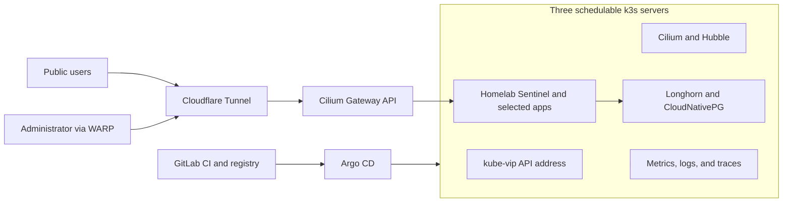

# k3s homelab

I am building this three-node homelab to practice the work expected of a platform and
DevSecOps engineer: provisioning Linux, operating highly available Kubernetes, shipping
through GitOps, securing the software supply chain, and proving recovery procedures.
This repository describes my real environment. It is not a generic cluster template.

> Current state: Phase 0 passes local validation; its GitLab pipeline has not run.
> Platform components remain planned and unverified on hardware.
> [See the evidence ledger](docs/STATUS.md).

## What this is intended to demonstrate

| Capability | Planned evidence |
| --- | --- |
| Three-node HA control plane | [Architecture](docs/architecture.md) and hardware verification |
| Reconciled GitOps delivery | Argo CD tree and recovery runbook |
| Zero inbound router ports | [Public surface](docs/security/public-surface.md) |
| Backup and disaster recovery | [DR documents](docs/dr/README.md) and measured results |
| Supply-chain security | Kyverno tests, SBOMs, Trivy reports, and Cosign verification |
| Full-stack observability | Prometheus rules, dashboards, Loki, Tempo, and SLOs |
| Canary delivery | Homelab Sentinel Rollout and Prometheus analysis |

## Hardware

| Node | Architecture | Role | Scheduling |
| --- | --- | --- | --- |
| `pc-1` | x86-64 | k3s server and embedded etcd member | Enabled |
| `pc-2` | x86-64 | k3s server and embedded etcd member | Enabled |
| `pc-3` | x86-64 | k3s server and embedded etcd member | Enabled |

Addresses, interfaces, domains, and external service identifiers live only in
[`config/homelab.yaml`](config/homelab.yaml).

## Build status

| Phase | Status |
| --- | --- |
| 0 — Skeleton and CI | Implemented; CI runner untested |
| 1 — Nodes and k3s | Implemented; pending hardware |
| 2 — Cilium | Implemented; pending hardware |
| 3 — Argo CD | Planned |
| 4 — Certificates, DNS, and access | Planned |
| 5 — Storage and backups | Planned |
| 6 — Runtime secrets | Planned |
| 7 — Observability | Planned |
| 8 — Policy and supply chain | Planned |
| 9 — Homelab Sentinel | Planned |
| 10 — Identity and self-hosted apps | Planned |
| 11 — Chaos and disaster recovery | Planned |
| 12 — Portfolio polish | Planned |

## Start here

- [Implementation plan](PLAN.md)
- [Build specification](docs/BUILD_SPEC.md)
- [Human-only inputs](HUMAN_TODO.md)
- [Current evidence](docs/STATUS.md)
- [Hardware verification](docs/VERIFY_ON_HARDWARE.md)
- [Skills demonstrated](docs/skills-demonstrated.md)

Run `make help` for repository entry points. Bootstrap commands are for Anouar to run
only after completing the human tasks and reading the matching runbooks.
