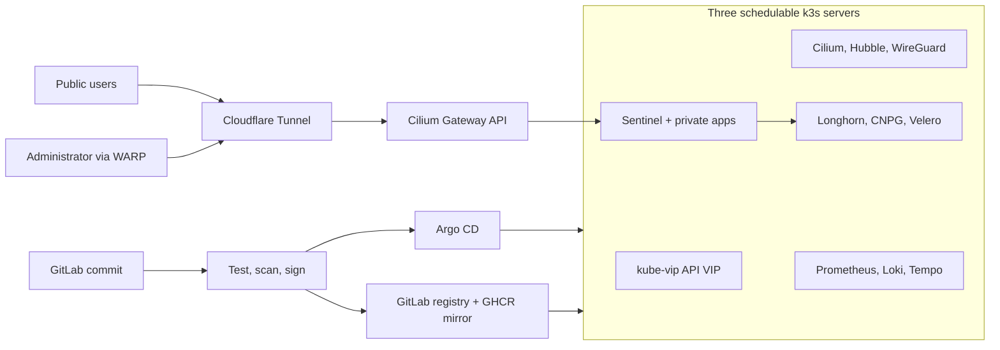

# Three-node k3s homelab

I built this repository to practice the platform engineering work behind a small,
defensible production system: Linux automation, highly available Kubernetes, GitOps,
zero-inbound-port access, supply-chain controls, observability, and recovery. It models
my three physical PCs; it is not presented as a generic cluster template.

## What it demonstrates

| Capability | Repository evidence | Runtime evidence |
| --- | --- | --- |
| Three-server HA | [Ansible and k3s design](docs/architecture.md) | [Pending node/VIP/quorum checks](docs/VERIFY_ON_HARDWARE.md) |
| GitOps reconciliation | [Restricted projects and sync waves](clusters/homelab/apps/) | Argo CD screenshot pending |
| Zero inbound router ports | [Public-surface boundary](docs/security/public-surface.md) | Tunnel/WARP checks pending |
| Backup and recovery | [Seven DR drills](docs/dr/README.md) | Result tables intentionally empty |
| Supply-chain security | [Policy and delivery flow](docs/architecture.md#phase-8-policy-and-supply-chain-flow) | GitLab/GHCR signatures pending CI |
| Full-stack telemetry | [Observability stack](observability/) | Dashboards and alerts pending hardware |
| Canary delivery | [Sentinel Rollout](apps/sentinel/) | Canary analysis pending hardware |
| Failure testing | [Bounded Chaos Mesh experiments](platform/chaos-mesh/) | Experiments pending hardware |

## Hardware and access

| Node | Architecture | Role | Scheduling |
| --- | --- | --- | --- |
| `pc-1` | x86-64 | k3s server + embedded etcd | Enabled |
| `pc-2` | x86-64 | k3s server + embedded etcd | Enabled |
| `pc-3` | x86-64 | k3s server + embedded etcd | Enabled |

The Kubernetes API floats behind kube-vip. Cilium replaces kube-proxy, announces LAN
service addresses, and encrypts cross-node pod traffic. Cloudflare Tunnel is the only
external ingress path; WARP carries private administration traffic. No router port is
opened. Environment-specific values appear only in
[`config/homelab.yaml`](config/homelab.yaml).

## Current state

Phases 0–11 pass the applicable offline lint, render, schema, policy, security, and
application gates. Nothing in this repository proves the physical cluster or external
accounts work yet. Only I can change `PENDING HARDWARE` to `Verified` after running the
recorded commands and capturing evidence.

- [Component status and evidence](docs/STATUS.md)
- [Observed validation output](PROGRESS.md)
- [Hardware verification ledger](docs/VERIFY_ON_HARDWARE.md)
- [Human-only account and recovery tasks](HUMAN_TODO.md)

## Explore

- [Architecture and data flows](docs/architecture.md)
- [Architecture decisions](docs/adr/README.md)
- [Operations runbooks](docs/runbooks/README.md)
- [Compatibility and upgrade order](docs/compatibility.md)
- [Evidence map](docs/evidence.md)
- [Skills demonstrated](docs/skills-demonstrated.md)
- [Screenshot checklist](docs/img/README.md)

Run `make help` to see the supported offline validation and guarded operational entry
points. Bootstrap and recovery commands are for my private administration session only.
