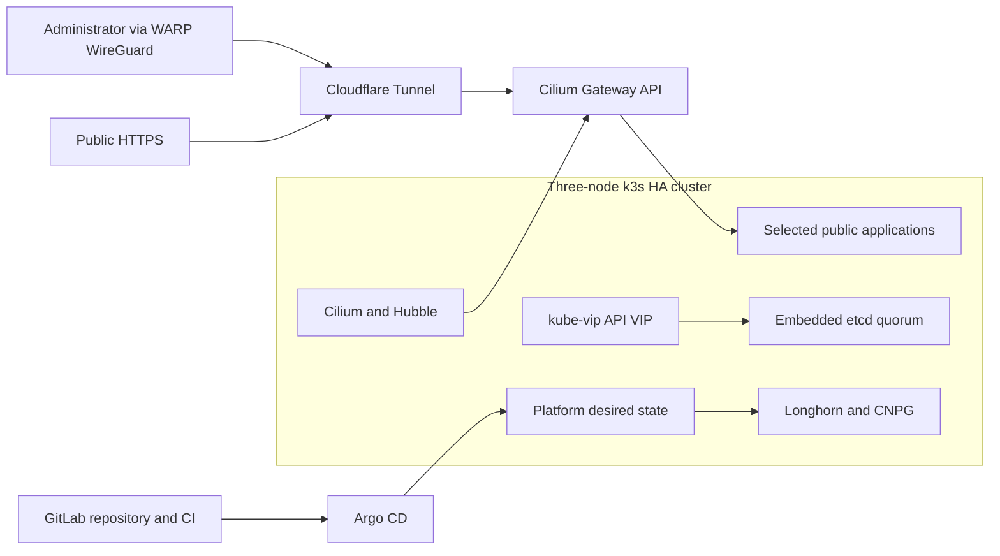
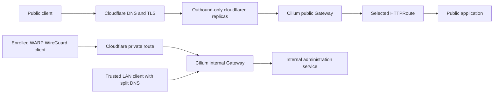

# Architecture

The target is a three-server k3s cluster with embedded-etcd quorum. kube-vip owns the
Kubernetes API virtual address. Cilium replaces kube-proxy, assigns LAN service
addresses, implements Gateway API, and encrypts eligible cross-node traffic.

Detailed network, storage, secrets, GitOps, delivery, and backup diagrams are completed
in Phase 12 and linked to observed evidence where available.

## Phase 4 edge traffic

The public and administrative paths share no router port. OpenTofu owns the temporary
public Tunnel CNAME. Internal names resolve only through split DNS and the internal
Gateway's centrally configured load-balancer address.
