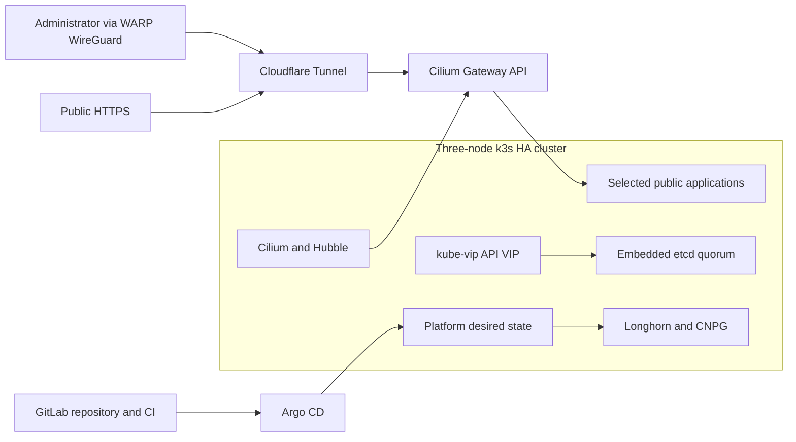
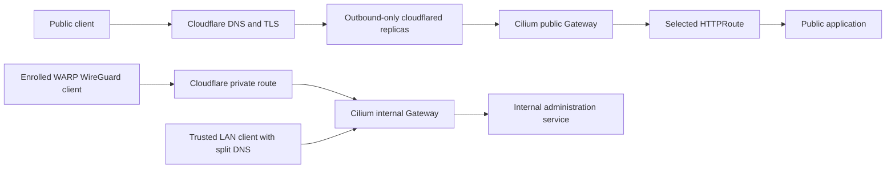
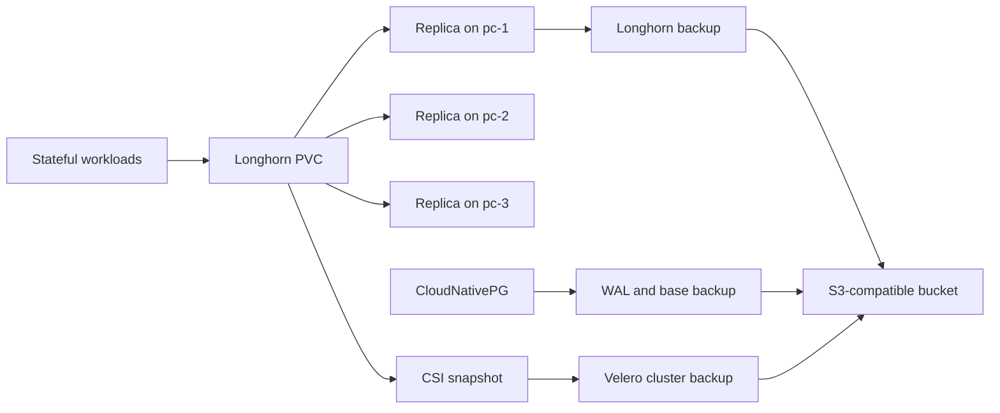
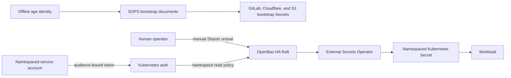
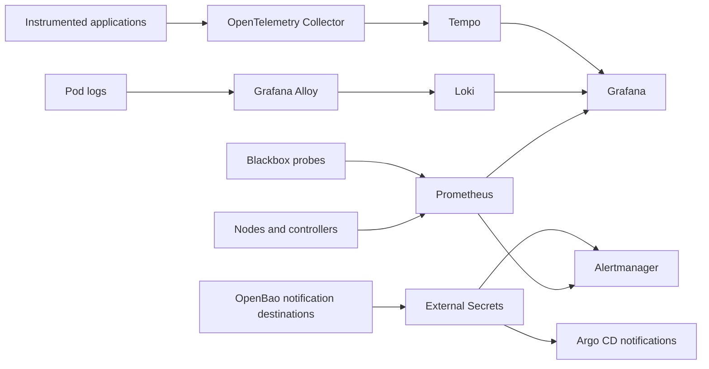

# Architecture

The target is a three-server k3s cluster with embedded-etcd quorum. kube-vip owns the
Kubernetes API virtual address. Cilium replaces kube-proxy, assigns LAN service
addresses, implements Gateway API, and encrypts eligible cross-node traffic.

Detailed network, storage, secrets, GitOps, delivery, and backup diagrams are completed
in Phase 12 and linked to observed evidence where available.

## Phase 4 edge traffic

The public and administrative paths share no router port. OpenTofu owns the temporary
public Tunnel CNAME. Internal names resolve only through split DNS and the internal
Gateway's centrally configured load-balancer address.

## Phase 5 storage and recovery

Local replicas provide availability, not disaster recovery. Longhorn, CNPG, and Velero
use separate prefixes and scoped credentials in the same centrally configured bucket.

## Phase 6 secret flow

SOPS cannot depend on OpenBao because it establishes the services needed to start and
recover OpenBao. Runtime consumers receive short-lived identities and cannot write
secret data. Manual unseal remains an explicit availability tradeoff.

## Phase 7 telemetry flow

The telemetry backends are internal only. Their Longhorn volumes improve local
availability, but telemetry remains disposable relative to application and backup data.
Alertmanager and Argo CD receive distinct notification destinations from OpenBao.
